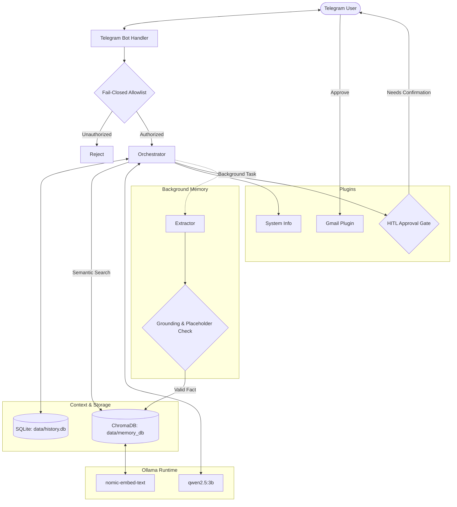

# ☀️ Summer: Privacy-First Local PC Assistant

Summer is a personal PC assistant controlled securely from your phone via Telegram. Powered by local LLMs through [Ollama](https://ollama.ai), it features long-term RAG memory, persistent SQLite conversation history, and approval-gated tool execution.

---

## ⚡ What It Does

- **Control Your PC via Telegram**: Send natural-language requests, ask questions, or retrieve information from anywhere.
- **Persistent Long-Term Memory**: Automatically remembers personal facts, preferences, contacts, and notes via ChromaDB vector embeddings and a background extractor.
- **Local & Private**: Runs 100% locally on your machine with Ollama — no cloud LLM API keys required.
- **Human-in-the-Loop (HITL) Safety**: Sensitive tools (such as sending emails) pause execution and require explicit one-tap Telegram approval (`Approve` / `Cancel`).
- **Low Hardware Footprint**: Optimized to fit entirely within consumer GPU memory (runs comfortably on **4 GB VRAM** with `qwen2.5:3b` and `nomic-embed-text`).

---

## 🖥️ Hardware Requirements

- **GPU**: NVIDIA RTX 3050 (4 GB VRAM) or equivalent / higher.
- **System RAM**: 16 GB recommended.
- **Models**:
  - Chat & Extraction: `qwen2.5:3b` (~1.9 GB VRAM)
  - Embeddings: `nomic-embed-text` (~274 MB VRAM)

### Multi-Model Concurrency Setting
To prevent Ollama from constantly unloading and reloading models between generation and embedding queries, configure Ollama to keep both models resident in memory simultaneously:

- **Windows**:
  ```cmd
  setx OLLAMA_MAX_LOADED_MODELS 2
  ```
  *(Restart terminal after setting)*

- **Linux / macOS**:
  ```bash
  OLLAMA_MAX_LOADED_MODELS=2 ollama serve
  ```

---

## 🚀 Quickstart

### 1. Prerequisites
- Python 3.11, 3.12, or 3.13.
- [Ollama](https://ollama.ai) installed and running.

Pull the required models:
```bash
ollama pull qwen2.5:3b
ollama pull nomic-embed-text
```

### 2. Setup Virtual Environment
```bash
git clone <repository-url>
cd pc_assistant
python -m venv .venv

# Windows
.venv\Scripts\activate

# Linux / macOS
source .venv/bin/activate

pip install -r requirements.txt
```

### 3. Configure Environment Variables
Copy `.env.example` to `.env`:
```bash
cp .env.example .env
```

1. Create a Telegram bot using [@BotFather](https://t.me/BotFather) and set `TELEGRAM_BOT_TOKEN`.
2. Find your personal Telegram user ID using [@userinfobot](https://t.me/userinfobot) and set `ALLOWED_USER_IDS`.
3. Optionally set your preferred names:
   ```env
   USER_NAME=Alex
   ASSISTANT_NAME=Summer
   ```

### 4. Run the Assistant
```bash
python main.py
```
By default, the assistant starts in long-polling mode with a FastAPI server listening on `http://0.0.0.0:8000`.

---

## 🏗️ Architecture



---

## 🧠 How Memory Works

1. **Background Extraction**: After replying to the user, an asynchronous task runs `extract_facts()` on the conversation turn.
2. **Strict Grounding Check**: Extracted facts are only stored if the fact value actually appears in the user's latest message (ignoring whitespace and punctuation). Values mentioned only in earlier assistant answers or context are dropped to prevent hallucination.
3. **Placeholder Filtering**: Placeholder values such as `"unknown"`, `"none"`, `"not provided"`, or `"n/a"` are rejected automatically.
4. **Subject + Attribute Upsert**: Facts are stored with structured keys (e.g., `subject="mom"`, `attribute="phone"`). Updating an existing attribute overwrites the old record deterministically.
5. **Distance Thresholding**: Memories are retrieved using cosine / L2 distance with a strict threshold (`MEMORY_MAX_DISTANCE=1.3`). Irrelevant facts are never returned for generic greetings or casual chat.

### Keeping Chats Off Disk
To run conversation history strictly in-memory without saving turns to disk:
```env
HISTORY_DB_PATH=:memory:
```

---

## ⚙️ Configuration Reference

| Variable | Default | Description |
|---|---|---|
| `TELEGRAM_BOT_TOKEN` | *Required* | Telegram Bot API token from [@BotFather](https://t.me/BotFather) |
| `ALLOWED_USER_IDS` | *Required* | Comma-separated Telegram user IDs authorized to use the bot |
| `USER_NAME` | `friend` | Name the assistant uses to address you |
| `ASSISTANT_NAME` | `Summer` | Persona name of the assistant |
| `OLLAMA_BASE_URL` | `http://localhost:11434` | Ollama service base URL |
| `OLLAMA_MODEL` | `qwen2.5:3b` | Primary chat LLM model |
| `OLLAMA_NUM_CTX` | `4096` | Context window size in tokens |
| `LLM_MAX_TOKENS` | `512` | Max generated tokens per reply |
| `LLM_TEMPERATURE` | `0.6` | Sampling temperature |
| `EXTRACTOR_MODEL` | `qwen2.5:3b` | Model used for background memory extraction |
| `EXTRACTOR_ENABLED`| `true` | Enable/disable background memory extraction |
| `DATA_DIR` | `data` | Base directory for application data |
| `HISTORY_DB_PATH` | `data/history.db` | SQLite history database path (or `:memory:`) |
| `MEMORY_DB_PATH` | `data/memory_db` | ChromaDB vector storage folder |
| `HISTORY_TURNS` | `8` | Number of recent conversation turns kept in context |
| `EMBEDDING_MODEL` | `nomic-embed-text` | Ollama embedding model |
| `MEMORY_TOP_K` | `5` | Maximum number of memories retrieved per query |
| `MEMORY_MAX_DISTANCE`| `1.3` | Semantic distance threshold for retrieval |
| `HITL_TIMEOUT_SECONDS` | `120` | Timeout in seconds for pending approval buttons |
| `SERVER_HOST` | `0.0.0.0` | Host interface for FastAPI server |
| `SERVER_PORT` | `8000` | Port for FastAPI server |
| `WEBHOOK_URL` | *(empty)* | Optional public URL for Telegram webhook mode |

---

## 🔒 Security

- **Fail-Closed Allowlist**: If `ALLOWED_USER_IDS` is empty or unset, the bot ignores all incoming messages, commands, and callbacks. Unauthorized users receive an access-denied message.
- **Human-in-the-Loop Safeguards**: Actions that send emails or make state changes require explicit interactive button confirmation before execution.
- **Local Storage**: Memory embeddings and chat histories are stored locally under `data/` in plain text / SQLite. Ensure appropriate filesystem permissions on your PC.
- **Secrets Management**: Never commit `.env` or files inside `credentials/`. Both are included in `.gitignore`.
- **Token Rotation**: If your Telegram bot token is ever exposed, revoke and regenerate it immediately via [@BotFather](https://t.me/BotFather).

---

## 🧪 Testing

Run the full automated test suite:
```bash
cd pc_assistant
python -u tests/test_suite.py
```
All tests mock external services and run hermetically without external network access.

---

## 📄 License

This project is licensed under the MIT License — see the [LICENSE](LICENSE) file for details.

