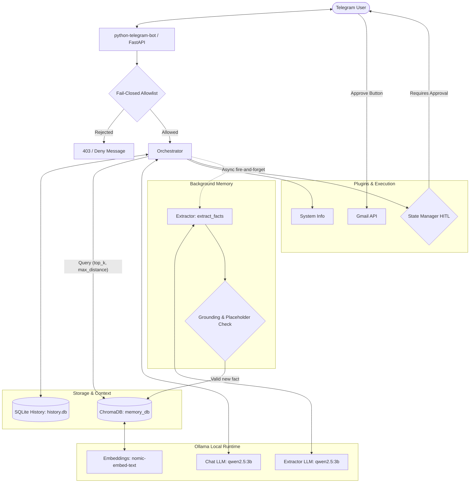

# Summer Architecture Overview

Summer is a lightweight, local-first PC assistant controlled over Telegram. It uses local LLMs and vector embeddings to converse, remember facts across sessions, and execute tools on the local machine with approval safety gates.

---

## High-Level System Architecture

---

## Component Breakdown

### 1. Gateway & Security
- **Entry points**: FastAPI webhook (`POST /webhook/{token}`) or long-polling mode.
- **Fail-closed allowlist**: Every incoming command, message, and callback query verifies `update.effective_user.id in ALLOWED_USER_IDS`. If `ALLOWED_USER_IDS` is unset or empty, all interaction is denied.

### 2. Conversation History & Persistence
- **Storage**: SQLite database (`data/history.db` or ephemeral `:memory:`).
- **Format**: Full message schema compliant with Ollama `/api/chat` (including `assistant` tool calls and `tool` responses).
- **Startup self-repair**: Drops unexecuted trailing assistant tool calls that did not survive a process restart and trims leading non-user messages.

### 3. Long-Term Memory (RAG)
- **Vector DB**: ChromaDB (`data/memory_db`) with `nomic-embed-text` embeddings.
- **Retrieval**: Multi-turn query expansion retrieves facts relevant to current and previous user messages, filtered by strict semantic distance threshold (`max_distance`).
- **Extraction**: Runs asynchronously in the background. The model extracts structured facts (`subject`, `attribute`, `value`).
- **Grounding validation**: Facts are rejected if the extracted value is not grounded directly in the user's latest turn or matches placeholder patterns (`"unknown"`, `"not provided"`).

### 4. Human-in-the-Loop (HITL) Safety
- Plugins flagged with `requires_approval = True` (e.g., sending emails) trigger an approval action in `StateManager`.
- Control returns to the Telegram interface with inline action buttons (`Approve` / `Cancel`).
- When approved, the action executes, appends the result to history, and resumes generation.

